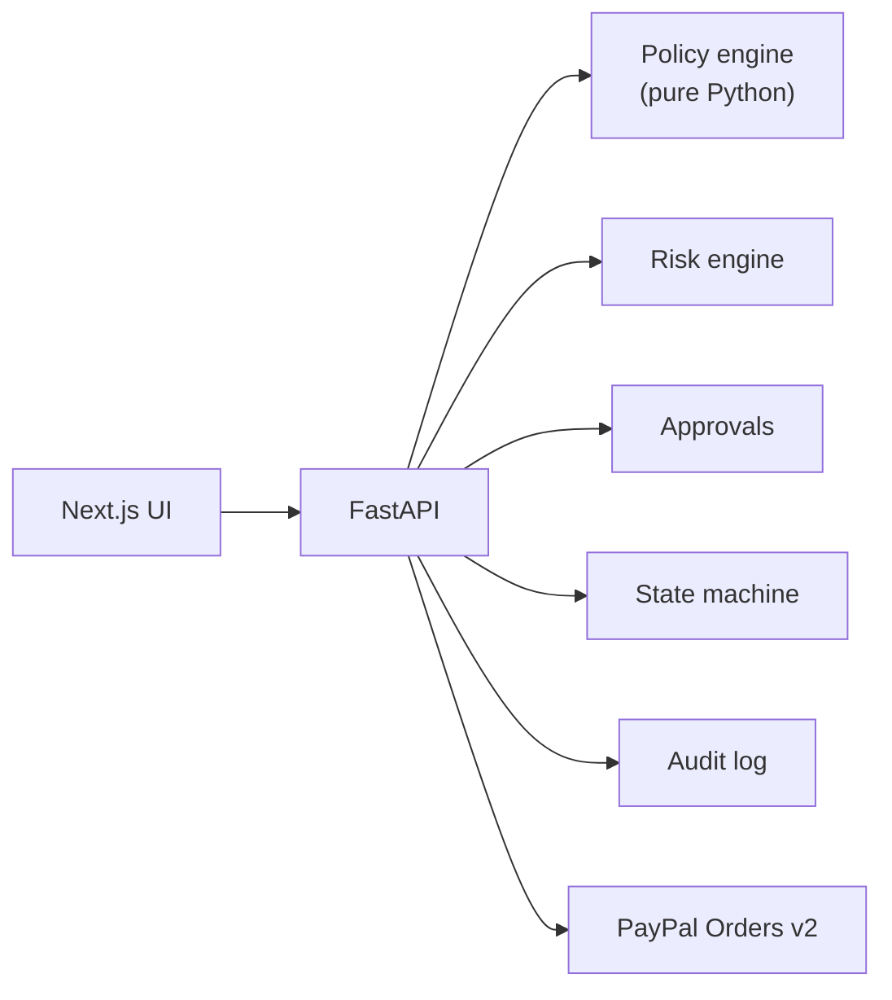

<div align="center">

# TRUSTLOOP AI

**Let AI buy. Let humans stay in control.**

A governance and authorization layer between autonomous AI shopping agents and PayPal.


-00457C?logo=paypal&logoColor=white)


</div>

---

## Overview

AI agents are getting good at shopping, but no one wants to give them an unlimited credit card. TRUSTLOOP AI places a trusted authorization layer between the agent and the payment provider:

1. Agents research and **propose** purchases.
2. A deterministic backend **policy engine decides**.
3. Humans **approve** what needs approving.
4. Only the trusted backend can create and capture PayPal Sandbox orders.
5. Every step is **audited**.

> **Status:** working MVP, built and tested in a sandbox without Gemini/PayPal/PostgreSQL credentials. See [`PROJECT_STATUS.md`](PROJECT_STATUS.md) for exactly what was and was not verified.
>
> **Live PayPal and Gemini calls have not been exercised yet. Do that first (steps below).**

## Architecture



`Next.js UI → FastAPI → { policy engine (pure Python) · risk engine · approvals · state machine · audit log } → PayPal Orders v2`

Gemini is used only for structured output (policy parsing, intent extraction, summaries, advisory risk signals) with **no tools registered**. Its output is Pydantic-validated and never applied automatically.

Further reading: [`docs/architecture.md`](docs/architecture.md) and [`docs/security.md`](docs/security.md).

## Quick start (Windows PowerShell)

**Prerequisites:** Python 3.11+, Node 20+.

### 1. Backend

```powershell
cd backend
python -m venv .venv
.\.venv\Scripts\Activate.ps1          # if blocked: Set-ExecutionPolicy -Scope Process Bypass
pip install -r requirements.txt
Copy-Item ..\.env.example .env        # then edit .env (JWT_SECRET is required)
python -c "import secrets; print(secrets.token_urlsafe(48))"   # paste into JWT_SECRET
alembic upgrade head                  # creates tables (works for SQLite and PostgreSQL)
uvicorn app.main:app --reload --port 8000
# API docs: http://localhost:8000/docs
```

### 2. Frontend (new terminal)

```powershell
cd frontend
"NEXT_PUBLIC_API_URL=http://localhost:8000" | Out-File -Encoding ascii .env.local
npm install
npm run dev                           # http://localhost:3000
```

The backend starts without Gemini or PayPal credentials; those features show clear "not configured" messages. Without a Gemini key the policy parser uses a labelled regex fallback.

### 3. First login

Click **Create demo setup** on the dashboard. It creates the ₹75,000 / ₹25,000 policy, three approved merchants and three labelled `[DEMO]` agents.

## Credentials you must supply

| Variable | Where to get it |
|---|---|
| `JWT_SECRET` | Generate locally (command above) |
| `GEMINI_API_KEY`, `GEMINI_MODEL` | Google AI Studio. Default `gemini-3.8-flash` (listed as stable in the official model docs on 2026-11-04). After setting your key, sign in and open `GET /api/health/gemini` in Swagger (`/docs`) to confirm the model exists for your key. |
| `PAYPAL_CLIENT_ID`, `PAYPAL_CLIENT_SECRET` | PayPal Developer Dashboard → Sandbox app |
| `PAYPAL_WEBHOOK_ID` | Sandbox app → add webhook → `https://<public-backend>/api/payments/webhook`; events: `PAYMENT.CAPTURE.COMPLETED/DENIED/REFUNDED/REVERSED`. Needs a public URL (use the Render deploy or a tunnel). |
| `DATABASE_URL` | Supabase → Project Settings → Database → connection string (optional; SQLite works locally) |

Use a Sandbox **buyer** account to approve checkout. No real money moves.

> **Currency:** PayPal may not settle INR for every account. Orders are created in `PAYPAL_CURRENCY` (default USD), converted server-side from the authoritative DB amount at a fixed **demo** rate (`INR_PER_UNIT_PAYPAL_CURRENCY`). Set `PAYPAL_CURRENCY=INR` if your sandbox accounts support it.

## Tests

```powershell
cd backend;  pytest -q          # 167 tests: engine, 10 scenarios, security, catalog/search, providers, budget, Gemini resilience
cd frontend; npm test           # 41 component/util tests
cd frontend; npm run typecheck; npm run build
```

External services are mocked **only inside tests** (or served by local fake servers).

## Product catalog and search

> **The catalog is curated demo data. It does not represent live retailer inventory.** Prices, specs and stock status are illustrative even where a real brand/model name is used (the first ten original SKUs use fictional brands). A live provider will be added later behind the same `Product` model without changing the policy engine. See [`docs/catalog-and-search.md`](docs/catalog-and-search.md).

- **36 products** across electronics (laptops, smartphones, headphones, keyboard, monitor), clothing, footwear, books and furniture, each with category-specific attributes (laptop: RAM/storage/battery; clothing: size/colour/gender/material; shoes: size/colour/type; books: author/genre/language), plus brand, model, merchant, availability and `image_url`.
- **Search never silently ignores a requirement.** Brand, model, budget and every spec become explicit checks. A product is a *match* only if all pass; otherwise it is listed separately as an *alternative* with what it fails. Asking for "Asus Vivobook X16" (not in the catalog) returns "isn't in the catalog", the same-line models labelled as different models, and no false "meets all requirements".
- Terms the parser can't map are reported as "could not verify", never dropped. Out-of-stock products can't be proposed.
- **Images:** the bundled `frontend/public/catalog/*.svg` are *original generic illustrations*, tagged "Illustration" in the UI, not product photos. Add licensed photos and set `image_url`/`image_source` to replace them (see `frontend/public/catalog/README.md`). Missing/broken images fall back to a placeholder.
- **Summaries state their author.** The UI shows "Generated by Gemini · <model>" or "Template summary (not AI)" with the reason Gemini wasn't used (not configured, model not found, rate limit...). Failures are logged server-side with API keys redacted.
- **Category grants:** agents can only buy in categories they're granted (`electronics`, `clothing`, `footwear`, `books`, `furniture`). The demo setup adds **FashionAgent** and **BookAgent**; add the new demo merchants (`StyleHub India`, `SoleStreet`, `PageTurner Books`) to your allowlist in Policy Builder if you set up before this update.

### Real product photos and "A to Z" shopping (demo provider)

Besides the built-in catalog, search also queries **DummyJSON** (`PRODUCT_PROVIDERS=curated,dummyjson`, on by default): a free *fake-store* API with ~190 products and real product photos across ~24 categories (laptops, phones, clothing, shoes, beauty, fragrances, groceries, furniture, home, sports, watches, bags...). Results are cached in your database so proposals, approvals and PayPal all use one authoritative price.

- **It is not a real retailer.** Prices are fake USD converted to INR at a demo rate; stock isn't real. Photos are labelled "Demo photo" (shown on a light backdrop so transparent product shots are visible); built-in illustrations are labelled "Illustration". Product cards say "Demo provider".
- It needs outbound internet from your backend. If it's unreachable, the UI says so and shows built-in results only. Set `PRODUCT_PROVIDERS=curated` to turn it off.
- Amazon/Flipkart listings and photos can't be used without their official partner APIs/licences. The provider layer (`backend/app/providers/`) is built so a real source can be added later without touching the policy engine.
- All provider items come from the merchant **"DummyJSON Demo Store"**. If it's not on your approved list, purchases need your review. Search results show this and offer **Add ... to approved merchants** (one click, audited).
- **Agents and categories:** an agent can only buy in categories you grant. In **Agents** use **Select all** for a general-purpose agent, or click **Add demo agents** (creates FashionAgent, BookAgent and GeneralShoppingAgent if missing).

### PayPal Sandbox checkout

- Sign in to the PayPal popup with a **Sandbox buyer (Personal) account** from developer.paypal.com → Sandbox → Accounts, not your real PayPal login. After you approve, the backend captures and verifies the payment; the transaction becomes `CAPTURED` with a receipt.
- Allow pop-ups for the site. The buttons render directly on the dark card (PayPal's light iframe is made transparent; otherwise a dark page paints it white).
- **Debit or Credit Card button:** orders used to be created locked to the PayPal wallet (`payment_source.paypal`), which is incompatible with the card button. They are now funding-agnostic. *Orders created before this update stay wallet-only: cancel that proposal and create a new one to test the card button.* Card guest checkout depends on your sandbox/business account country; if it isn't available, hide it with `PAYPAL_DISABLE_FUNDING=card`. PayPal errors now show their issue code (e.g. `CURRENCY_NOT_SUPPORTED`).

### Budget and "BLOCKED" proposals

Your policy's `max_budget` is a **total** across purchases. Anything *approved but not yet paid* reserves budget, so an unpaid ₹62,990 laptop leaves only ₹12,010, and a ₹52,990 laptop is then `BLOCKED` with `budget_remaining`. The block explanation states what is already committed.

- On **AI Shopping**, the **Budget panel** shows what is used/remaining and which proposals hold it, with a **Cancel** button for unpaid ones (also in Transactions → details).
- Unpaid authorizations release their budget automatically when they expire (default 30 min).
- Paid purchases count permanently.

## Troubleshooting Gemini

1. Open Swagger (`/docs`), sign in via `/api/auth/login`, **Authorize**, then call `GET /api/health/gemini`. `ok: true` means the key and model work.
2. The UI always shows who produced a summary/interpretation: "Generated by Gemini · model" or a "Template/Rule-based" badge **with the reason** (`model_not_found`, `invalid_api_key`, `rate_limited`, `network_error`...).
3. Server logs show the failure with keys redacted (logger `trustloop.gemini`).
4. **HTTP 503/504 from Gemini** are Google-side overload/timeouts. The backend retries transient errors (2 retries, short backoff), then falls back to `GEMINI_FALLBACK_MODEL` (default `gemini-3.5-flash-lite`), and pauses Gemini calls for ~30 s after a full outage so searches stay fast. The badge shows which model really answered ("fallback model" when it wasn't your primary). We no longer force `temperature=0` (Google recommends the default for Gemini 3) or a thinking level (`minimal` is rejected by some models).
5. **Which model answered, and why the primary failed:** the badge says "(fallback model)" when `GEMINI_FALLBACK_MODEL` answered, and the page explains the primary's last failure. For the exact reason call **`GET /api/health/gemini/probe`** in Swagger (it sends one tiny plain and one structured request to each model and reports latency and classified errors; `?models=gemini-3.6-flash` tests other model names). If the fallback works and the primary doesn't, set `GEMINI_MODEL` to the one that works. A failing primary is skipped for `GEMINI_MODEL_COOLDOWN_SECONDS` (default 120) so searches aren't slowed by retries.
6. *Fixed earlier:* earlier builds failed every call with `Gemini request failed (RuntimeError)` due to a client-lifetime bug in the wrapper (the SDK closed its connection mid-call). Update the backend and restart.

## Upgrading an existing install

```powershell
cd backend
git pull   # or copy the new files
pip install -r requirements.txt
alembic upgrade head      # applies migration 0002 (brand/model/type/availability/image columns)
# SQLite created before this update (via create_all, no alembic table): delete backend\trustloop.db and restart instead.
```

On startup the app upserts the curated catalog by SKU.

> **Model name change:** if your `.env` still says `GEMINI_MODEL=gemini-3.5-flash`, change it to `gemini-3.8-flash`. `gemini-3.5-flash` is not in the official stable model list, and calling it fails (the UI now shows this instead of hiding it).

## Demo scenarios

All ten are automated in `backend/tests/test_scenarios.py`. The manual script is in [`docs/demo-script.md`](docs/demo-script.md).

| # | Scenario | Outcome |
|:-:|---|---|
| 1 | ₹15,000 purchase | `APPROVED` |
| 2 | ₹30k+ purchase | `REQUIRES_APPROVAL` |
| 3 | ₹80k+ purchase | `BLOCKED` |
| 4 | Inactive agent | `BLOCKED` |
| 5 | Duplicate purchase | `BLOCKED` |
| 6 | Unapproved merchant | `REVIEW` |
| 7 | Expired approval | Payment rejected |
| 8 | Changed amount | Approval invalidated |
| 9 | Repeated capture | Single capture |
| 10 | Prompt-injection product | Still policy-evaluated |

## Deployment (not yet performed)

| Layer | Steps |
|---|---|
| Supabase (Postgres) | Set `DATABASE_URL`, run `alembic upgrade head` once. |
| Render (backend) | Root `backend`, build `pip install -r requirements.txt`, start `uvicorn app.main:app --host 0.0.0.0 --port $PORT`, set env vars, `CORS_ORIGINS=<vercel url>`. |
| Vercel (frontend) | Root `frontend`, env `NEXT_PUBLIC_API_URL=<render url>`. |

## Stack

- **Frontend:** Next.js 14 (App Router), React 18, TypeScript, Tailwind, shadcn/ui-style primitives (hand-written with Radix + CVA, not CLI-generated), Lucide, Recharts
- **Backend:** FastAPI, Pydantic, SQLAlchemy, Alembic, HTTPX, PostgreSQL/SQLite
- **Integrations:** `google-genai`, PayPal Orders v2, DummyJSON (demo product provider)

## License

See [`LICENSE`](LICENSE).
