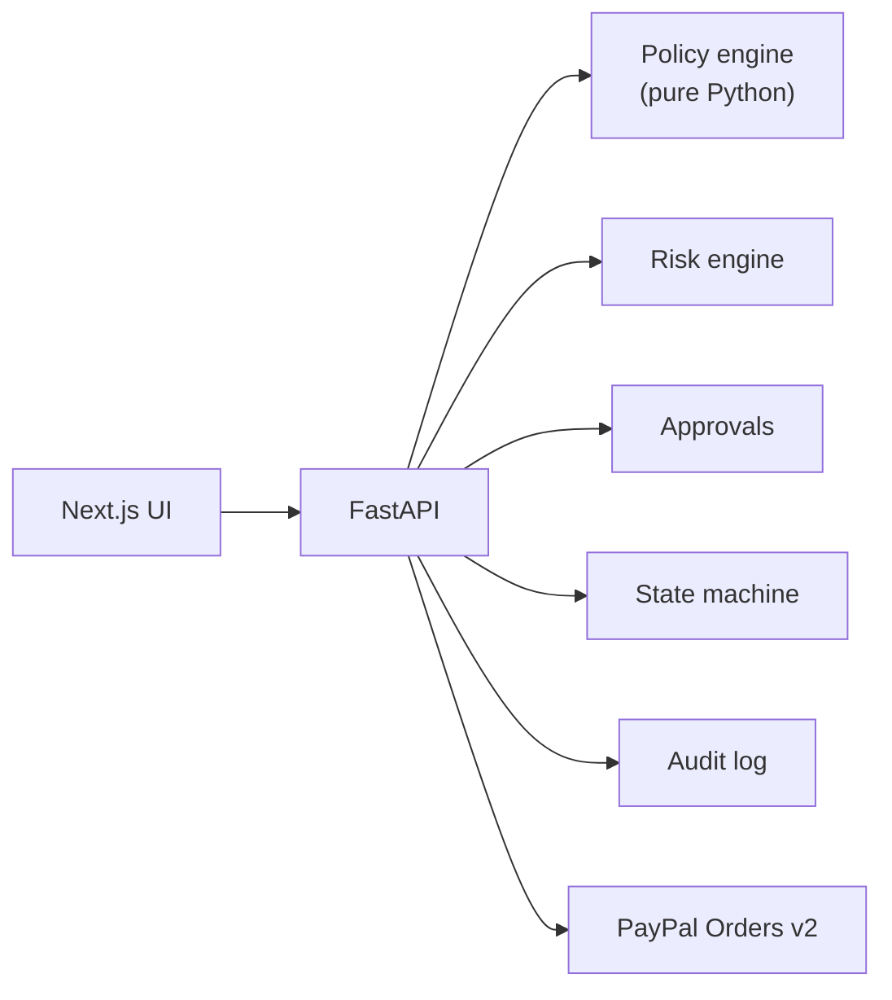

<div align="center">

# TRUSTLOOP AI 

**Let AI buy. Let humans stay in control.**

A governance and authorization layer between autonomous AI shopping agents and PayPal.


-00457C?logo=paypal&logoColor=white)


</div>

---

## Overview

AI agents are getting good at shopping, but no one wants to give them an unlimited credit card. TRUSTLOOP AI places a trusted authorization layer between the agent and the payment provider:

1. Agents research and **propose** purchases.
2. A deterministic backend **policy engine decides**.
3. Humans **approve** what needs approving.
4. Only the trusted backend can create and capture PayPal Sandbox orders.
5. Every step is **audited**.

> **Status:** working MVP, built and tested in a sandbox without Gemini/PayPal/PostgreSQL credentials. See [`PROJECT_STATUS.md`](PROJECT_STATUS.md) for exactly what was and was not verified.
>
> **Live PayPal and Gemini calls have not been exercised yet. Do that first (steps below).**

## Architecture



`Next.js UI → FastAPI → { policy engine (pure Python) · risk engine · approvals · state machine · audit log } → PayPal Orders v2`

Gemini is used only for structured output (policy parsing, intent extraction, summaries, advisory risk signals) with **no tools registered**. Its output is Pydantic-validated and never applied automatically.

Further reading: [`docs/architecture.md`](docs/architecture.md) and [`docs/security.md`](docs/security.md).

## Quick start (Windows PowerShell)

**Prerequisites:** Python 3.11+, Node 20+.

### 1. Backend

```powershell
cd backend
python -m venv .venv
.\.venv\Scripts\Activate.ps1          # if blocked: Set-ExecutionPolicy -Scope Process Bypass
pip install -r requirements.txt
Copy-Item ..\.env.example .env        # then edit .env (JWT_SECRET is required)
python -c "import secrets; print(secrets.token_urlsafe(48))"   # paste into JWT_SECRET
alembic upgrade head                  # creates tables (works for SQLite and PostgreSQL)
uvicorn app.main:app --reload --port 8000
# API docs: http://localhost:8000/docs
```

### 2. Frontend (new terminal)

```powershell
cd frontend
"NEXT_PUBLIC_API_URL=http://localhost:8000" | Out-File -Encoding ascii .env.local
npm install
npm run dev                           # http://localhost:3000
```

The backend starts without Gemini or PayPal credentials; those features show clear "not configured" messages. Without a Gemini key the policy parser uses a labelled regex fallback.

### 3. First login

Click **Create demo setup** on the dashboard. It creates the ₹75,000 / ₹25,000 policy, three approved merchants and three labelled `[DEMO]` agents.

## Credentials you must supply

| Variable | Where to get it |
|---|---|
| `JWT_SECRET` | Generate locally (command above) |
| `GEMINI_API_KEY`, `GEMINI_MODEL` | Google AI Studio. Verify the model name works for your key. |
| `PAYPAL_CLIENT_ID`, `PAYPAL_CLIENT_SECRET` | PayPal Developer Dashboard → Sandbox app |
| `PAYPAL_WEBHOOK_ID` | Sandbox app → add webhook → `https://<public-backend>/api/payments/webhook`; events: `PAYMENT.CAPTURE.COMPLETED/DENIED/REFUNDED/REVERSED`. Needs a public URL (use the Render deploy or a tunnel). |
| `DATABASE_URL` | Supabase → Project Settings → Database → connection string (optional; SQLite works locally) |

Use a Sandbox **buyer** account to approve checkout. No real money moves.

> **Currency:** PayPal may not settle INR for every account. Orders are created in `PAYPAL_CURRENCY` (default USD), converted server-side from the authoritative DB amount at a fixed **demo** rate (`INR_PER_UNIT_PAYPAL_CURRENCY`). Set `PAYPAL_CURRENCY=INR` if your sandbox accounts support it.

## Tests

```powershell
cd backend;  pytest -q          # 48 tests: engine, 10 scenarios, security, mocked Gemini/PayPal
cd frontend; npm test           # 8 component/util tests
cd frontend; npm run typecheck; npm run build
```

External services are mocked **only inside tests**.

## Demo scenarios

All ten are automated in `backend/tests/test_scenarios.py`. The manual script is in [`docs/demo-script.md`](docs/demo-script.md).

| # | Scenario | Outcome |
|:-:|---|---|
| 1 | ₹15,000 purchase | `APPROVED` |
| 2 | ₹30k+ purchase | `REQUIRES_APPROVAL` |
| 3 | ₹80k+ purchase | `BLOCKED` |
| 4 | Inactive agent | `BLOCKED` |
| 5 | Duplicate purchase | `BLOCKED` |
| 6 | Unapproved merchant | `REVIEW` |
| 7 | Expired approval | Payment rejected |
| 8 | Changed amount | Approval invalidated |
| 9 | Repeated capture | Single capture |
| 10 | Prompt-injection product | Still policy-evaluated |

## Deployment (not yet performed)

| Layer | Steps |
|---|---|
| Supabase (Postgres) | Set `DATABASE_URL`, run `alembic upgrade head` once. |
| Render (backend) | Root `backend`, build `pip install -r requirements.txt`, start `uvicorn app.main:app --host 0.0.0.0 --port $PORT`, set env vars, `CORS_ORIGINS=<vercel url>`. |
| Vercel (frontend) | Root `frontend`, env `NEXT_PUBLIC_API_URL=<render url>`. |

## Stack

- **Frontend:** Next.js 14 (App Router), React 18, TypeScript, Tailwind, shadcn/ui-style primitives (hand-written with Radix + CVA, not CLI-generated), Lucide, Recharts
- **Backend:** FastAPI, Pydantic, SQLAlchemy, Alembic, HTTPX, PostgreSQL/SQLite
- **Integrations:** `google-genai`, PayPal Orders v2

## License

See [`LICENSE`](LICENSE).